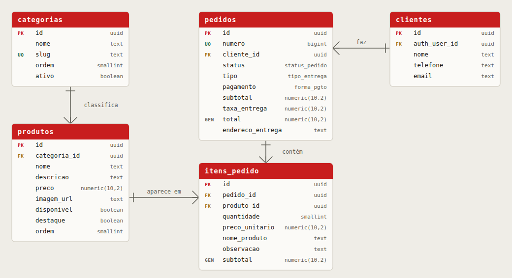

# Banco de dados — Cardápio Digital Pastelaria Miltão

Responsável: Adrian Rafa (Back-end e Dados)
Banco: PostgreSQL no Supabase — projeto `cardapio-miltao`, região São Paulo (sa-east-1)

## Recriar o banco do zero

No painel do Supabase: **SQL Editor → New query**, cole e rode **nesta ordem**:

1. `01_schema.sql` — tabelas, enums, índices, triggers e a view `vw_cardapio`
2. `02_rls.sql` — Row Level Security (não pule: sem isso o banco fica aberto)
3. `03_seed.sql` — cardápio da Miltão (deve terminar mostrando 19 produtos em 5 categorias)
4. `04_rpc_criar_pedido.sql` — função transacional que fecha o pedido

## Modelo



```
categorias  1 ──< produtos
clientes    1 ──< pedidos
pedidos     1 ──< itens_pedido >── 1  produtos
```

`itens_pedido` é a tabela associativa que resolve o N:N entre pedidos e produtos e guarda
quantidade, preço pago e observação.

## Como o app usa

Nenhuma tela chama o Supabase direto — as telas chamam as funções de `src/services/`.

| Quem | Usa |
|---|---|
| Home / Cardápio / Detalhe | `useCardapio()`, `listarDestaques()`, `buscarProduto(id)`, `formatarPreco(v)` |
| Carrinho / Pedidos | `criarPedido({...})`, `listarPedidosPorTelefone()`, `acompanharPedido()` |

Para finalizar o pedido **não envie preço nem total**: a função `criar_pedido()` lê o preço
da tabela `produtos` e devolve número, total e status.

## Configuração

Copie `.env.example` para `.env` na raiz e preencha com a URL do projeto e a
**Publishable key** (`sb_publishable_...`) do Supabase. A `.env` está no `.gitignore` e
nunca vai para o repositório.

Dependências:

```
npx expo install @supabase/supabase-js @react-native-async-storage/async-storage react-native-url-polyfill
```
